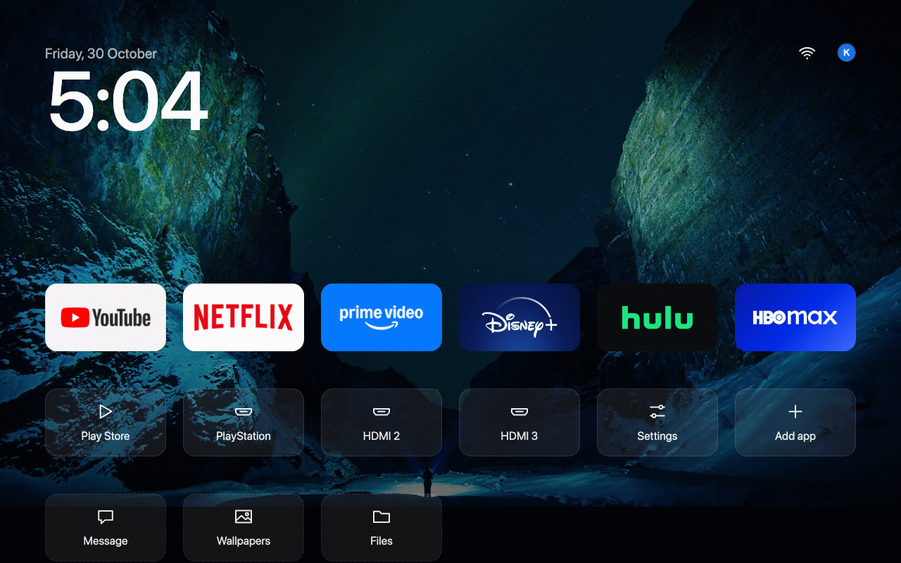
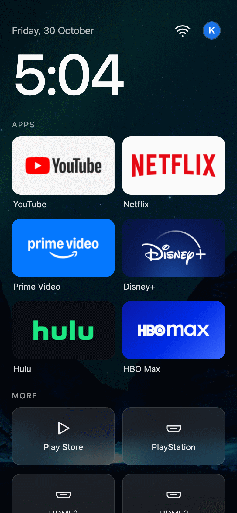
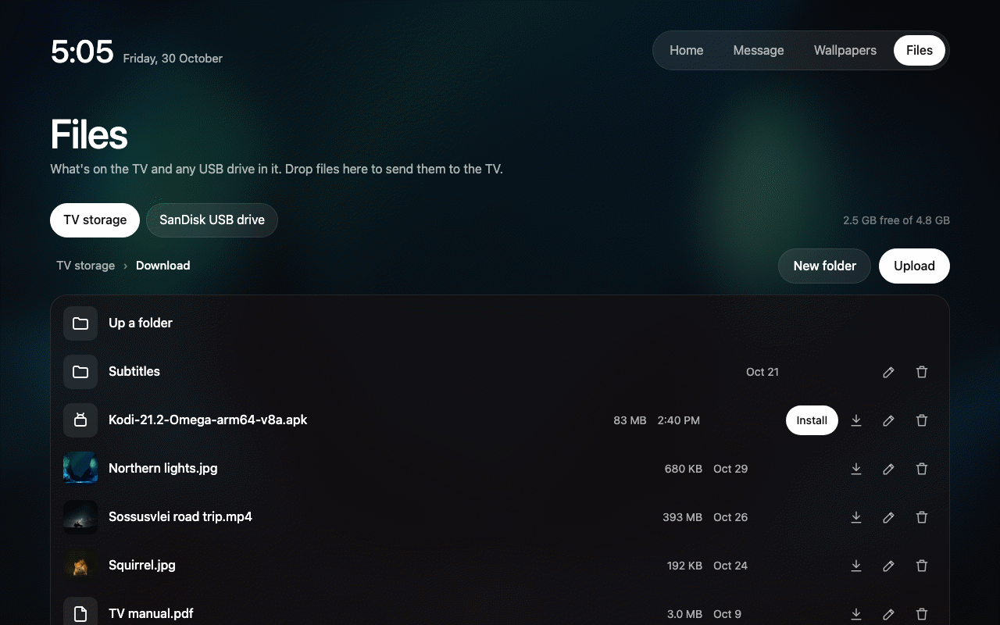
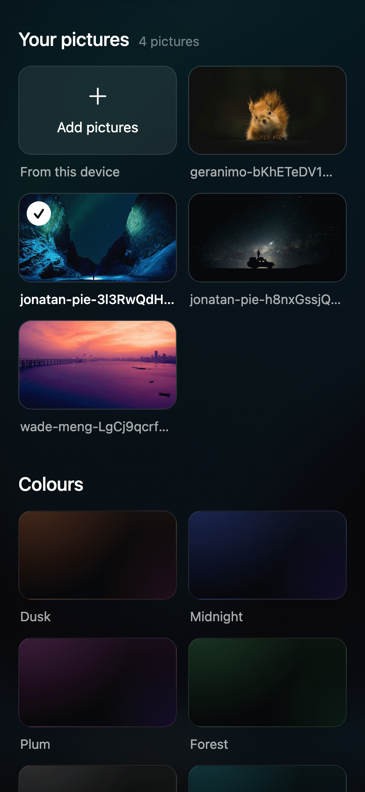
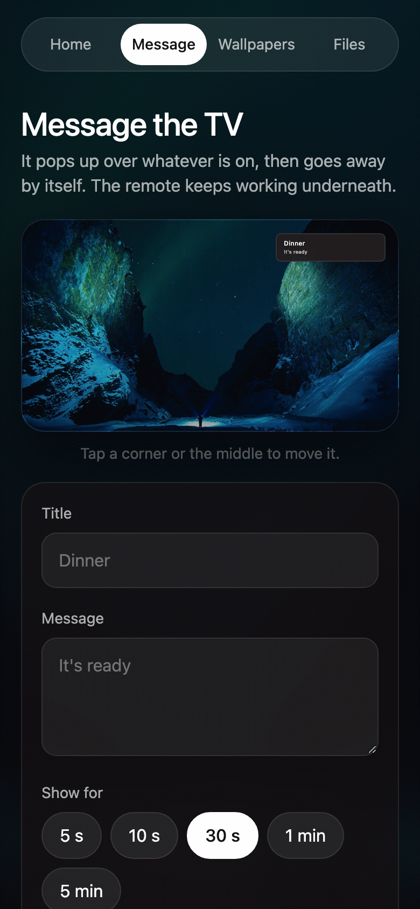

<div align="center">

# Telebisyon

### A calm, fast home screen for Android TV, that you can run from your phone.

Your apps, your photos and a clock on the TV. Messages, wallpapers and Home Assistant control from any phone on your Wi-Fi.

[](https://github.com/knznepo/telebisyon/releases/latest)
[](LICENSE)
[](https://github.com/Ansub/tv-detox)


</div>

Telebisyon is a fork of [**TV Detox**](https://github.com/Ansub/tv-detox) by Ansub Khan. It keeps TV Detox's home screen and adds a web page you open on your phone, your own photos, messages and smart home control.

Looking for the **TV cleanup** (turning off bloatware, ads and sponsored rows) or help with a **specific TV brand**? That's TV Detox's part. See [TV Detox's README](https://github.com/Ansub/tv-detox#readme).

## What Telebisyon adds

- **Your own photos** as wallpaper, shuffled on a timer, plus a **photo frame** when the TV sits idle.
- **A web page on the TV** (`http://<TV_IP>:7979`) for any phone or computer on your Wi-Fi: a live copy of the home screen whose tiles open on the TV, a message sender, a wallpaper manager and a **file manager** for the TV's storage and USB drives. It can sit behind a **PIN**.
- **Messages** over whatever is playing, compatible with PiPup, with an optional chime.
- **Call the TV** from a phone's browser, with video or audio only. It plays on the TV straight away, over whatever is on, without pausing it. Nobody has to answer. Audio only works like an intercom, with hold to talk.
- **Home Assistant control**: what's playing, pause and play, volume, open an app.
- **Banners for phone apps** that don't come with one, so every tile matches.
- **An account avatar** next to the network icon.
- **A clock that keeps itself right**: internet time and your time zone.
- **One-step setup** with `setup.sh`, and no build tools needed.

<table>
<tr>
<td width="60%" valign="top"><br><sub>The TV's home screen in a browser. Tap a tile to open it on the TV.</sub></td>
<td width="40%" valign="top"><br><sub>The same page on a phone.</sub></td>
</tr>
<tr>
<td valign="top"><br><sub>Files on the TV and USB drives.</sub></td>
<td valign="top"><br><sub>Wallpapers, shuffle and the photo frame.</sub></td>
</tr>
</table>

## Download and install

You need a computer on the same Wi-Fi as the TV, only for setup. After that, everything works from your phone.

**1. Get the TV ready.** On the TV, open **Settings → Device Preferences → About** and press **Build** 7 times until it says you're a developer. Then in **Developer options**, turn on **USB debugging** (and **Network debugging** if you see it). Note the TV's IP address from **Settings → Network & Internet**, for example `192.168.1.50`.

> Chromecast with Google TV and other newer Google TVs only have **Wireless debugging**, which needs pairing first. See [TV Detox's developer mode help](https://github.com/Ansub/tv-detox#help).

**2. Install adb** on the computer:

| Computer | Command |
|---|---|
| Mac | `brew install android-platform-tools` (with [Homebrew](https://brew.sh)) |
| Linux | `sudo apt install adb curl` |
| Windows | Follow the Windows steps in [GUIDE.md](GUIDE.md) |

**3. Download Telebisyon.** Get **Source code (zip)** from the [latest release](https://github.com/knznepo/telebisyon/releases/latest) and unzip it.

**4. Install it.** In a terminal, in the unzipped folder:

```sh
sh setup.sh 192.168.1.50
```

This downloads the home screen, installs it, turns on the phone pages, sets the TV's clock and copies any photos in the `wallpapers` folder.

- The first time, the TV asks **"Allow USB debugging?"**. Tick **Always allow**, press **OK**, and run the command again if it stopped.
- **Recommended:** add a PIN for the phone pages, and turn on the Files page: `PIN=123456 FILES=1 sh setup.sh 192.168.1.50`.

**5. Make it open with the Home button.** This depends on your TV:

| Your TV | What to do |
|---|---|
| **Android TV** (older Sony, Philips, Xiaomi, TCL, projectors) | Nothing more. `setup.sh` asks to turn off the TV's own home screen: answer **y**. |
| **A TV with Google TV** (Sony BRAVIA from 2021, TCL, Hisense and others with the Google TV "For you" screen) | Home keeps opening Google TV. Run setup again with: `GOOGLE_TV=1 YES_SETUP=1 sh setup.sh 192.168.1.50` |
| **Chromecast with Google TV, Google TV Streamer** | Leave it as it is: Home opens Google TV, and you open Telebisyon from the apps row. Everything on your phone still works. |

`GOOGLE_TV=1` turns off (never deletes) Google TV's home screen, and `YES_SETUP=1` also turns off Google TV's setup app if it then takes over Home, which is what Sony BRAVIA needs. Before you use them:

- **Only if you're connected over USB, or with Network debugging (port 5555).** Turning Google TV's home off has left some Google TVs stuck restarting; this way you can always reconnect and run `sh undo.sh 192.168.1.50` to turn everything back on. Over Wireless debugging (pairing code), the connection can drop, so don't.
- You lose Google TV's own home: "For you" recommendations, profiles and the Google TV rows. Your apps and the Play Store keep working.
- If it says it's leaving the setup app on because it saved your Wi-Fi, do what it says: forget your Wi-Fi on the TV, join it again, then run it again.
- Afterwards, restart the TV once and check it starts normally.

**6. Turn debugging off** in **Developer options** when you're done. While it's on, other devices on your network can ask to control the TV. Turn it back on only to update or undo.

[**GUIDE.md**](GUIDE.md) has the same steps in more detail for **Mac, Linux and Windows**.

> [!WARNING]
> **Use it at your own risk:** it turns off system apps, and a few TVs got stuck at the logo or kept restarting. **OLED TVs:** keep the screensaver on so a still picture doesn't burn into the screen. See [TV Detox's notes and warnings](https://github.com/Ansub/tv-detox#notes-and-warnings).

## Use it

### On the TV

| To… | Do this |
|---|---|
| Open an app | Select it and press **OK** |
| Move, replace or remove an app | Hold **OK** on it |
| Add an app | **Add app** tile |
| Rename an HDMI input | Hold **OK** on it |
| Change the wallpaper | **Settings** tile → **Wallpaper** |
| Leave the photo frame | Press any button |

<a id="web-page"></a>
### From a phone or computer on the same Wi-Fi

| Open… | To… |
|---|---|
| `http://<TV_IP>:7979` | See the TV's home screen and tap an app to open it on the TV |
| `http://<TV_IP>:7979/message` | Send a message that pops up over whatever is playing |
| `http://<TV_IP>:7979/wallpapers` | Upload photos, pick the wallpaper, shuffle them, set up the photo frame and your profile picture |
| `http://<TV_IP>:7979/files` | Browse the TV and USB drives, upload, download, rename, delete and install APKs. Off until you run `sh files.sh <TV_IP>` |
| `http://<TV_IP>:7979/call` | Call the TV with video or audio only. It plays on the TV straight away |

Tip: add these to your phone's home screen (in the browser's Share menu, choose **Add to Home Screen**).

## FAQ

<details>
<summary><b>How do I use my own photos?</b></summary>
<br>

Upload them on `http://<TV_IP>:7979/wallpapers`, or put them in the `wallpapers` folder and run `sh wallpapers.sh <TV_IP>`. On the TV, pick one under **Settings → Wallpaper**, after the fourteen colour gradients. JPEG, PNG, WebP, BMP or GIF; a landscape picture the size of the screen fits best. With two or more, the list ends with **Shuffle pictures**.

**Photo frame:** when Home sits untouched for a while (5 minutes unless you change it on the web page), your pictures go by full screen with a big clock. Any button brings Home back. Set it to **Off** on the web page if you don't want it. If the TV's own screensaver starts first, set it later in the TV's settings.

The sample photos in `wallpapers/` are from Unsplash; see [credits](#credits).

</details>

<details>
<summary><b>Can I put the web pages behind a PIN?</b></summary>
<br>

Yes: `sh pin.sh <TV_IP> 123456` (4 or more digits or letters; longer is safer). Each browser asks for it once. After 5 wrong tries, no more are accepted for a minute. `sh pin.sh <TV_IP> off` removes it, and a new PIN signs every browser out. Without a PIN, anyone on your Wi-Fi can open the pages.

Messages (`POST /notify`) never need the PIN, so PiPup senders keep working. Everything else does: scripts and Home Assistant send it as an `X-Pin` header.

To turn the web page off completely: `sh messages.sh <TV_IP> off`.

</details>

<details>
<summary><b>How does the file manager work?</b></summary>
<br>

It's off until you turn it on, because it can see and delete what's on the TV:

```sh
sh pin.sh <TV_IP> 123456      # a PIN first (recommended)
sh files.sh <TV_IP>           # turn the Files page on (off: sh files.sh <TV_IP> off)
```

Then on `http://<TV_IP>:7979/files`: browse the TV's storage and any USB drive or memory card, upload by dragging files onto the page, open or download, rename, delete, make folders, and install an APK (someone still has to press **Install** on the TV; Android requires it). It only reaches shared storage, not other apps' private data.

</details>

<details>
<summary><b>Can I send messages to the TV, like PiPup?</b></summary>
<br>

Yes. Use the web page, or `sh send.sh <TV_IP> "Title" "Message"`. A message shows in a corner over whatever is playing and goes away by itself (after 30 seconds unless you choose otherwise).



```sh
DURATION=10 POSITION=4 sh send.sh <TV_IP> "Dinner" "It's ready"     # centred, for 10 seconds
SOUND=1 sh send.sh <TV_IP> "Door" "Someone's here"                  # with a chime
IMAGE=http://camera.local/snap.jpg sh send.sh <TV_IP> "Front door" ""
BOX=0 IMAGE_SIZE=50 IMAGE=https://example.com/logo.png sh send.sh <TV_IP> "" ""   # floating, half the screen wide
sh send.sh <TV_IP> --cancel                                          # take it away early
```

**Floating pictures:** turn off **Box behind it** on the web page (or `BOX=0`) and a transparent PNG floats on the screen with no card around it; text gets a shadow instead. **Picture size** (or `IMAGE_SIZE`, in percent of the screen's width) goes from small up to full screen.

It speaks PiPup's API on port 7979 (`POST /notify` with `title`, `message`, `duration`, `position`, colours, sizes and `media.image.uri`, plus `"sound": true` for the chime, `"box": false` and `"imageSize": 50`), so anything already set up for PiPup works as it is.

</details>

<details>
<summary><b>Can I call the TV from my phone?</b></summary>
<br>

Yes, one way. Open **Call** on the TV's web page (or the **Call** tile), pick **Video** or **Audio only**, and tap **Start call**. It plays on the TV straight away, over whatever is on, and nobody has to answer. **End call**, or closing the page, takes it off the TV and turns your camera and microphone off.

| Call with | On the TV |
|---|---|
| **Video** | Your camera and your voice, full screen or in a corner |
| **Audio only** | Your voice, over whatever is on. A small **Phone** badge shows in the corner only while you're talking. Your camera stays off. |

During the call you can switch between **Video** and **Audio only**, the **Front** or **Back** camera, and **Full screen** or **Corner**. While the call is on, the phone shows **On the TV · it hears you** when your voice is reaching the TV.

**Like an intercom:** with **Audio only**, pick **Hold to talk** (the default) or **Always on**. With Hold to talk, the call stays open and the TV only hears you while you hold the big button, so you can speak whenever you need to.

**First time:**

1. The page explains a one-off step: browsers only let a page use the camera and microphone over a secure (https) connection, so calls open on the TV's secure address, `https://<TV_IP>:7980/call`. Tap **Continue**.
2. Your browser warns that the connection isn't private, because the TV made its own certificate. Tap **Advanced**, then **Proceed** (on iPhone: **Show details**, then **visit this website**).
3. Allow the camera and microphone when asked.

It only warns again if the TV's IP address changes, or once a year. Set a fixed IP for the TV in your router to avoid the first.

**Good to know:**
- **The TV can't see or hear you back.** TVs have no camera, and apps can't use the remote's microphone.
- **One call at a time.** A new call replaces the one on the TV.
- The video goes straight from the phone to the TV over your Wi-Fi, never through the internet. Calls need the PIN if you set one.
- **It doesn't interrupt what's on.** Your voice plays over the show, at the TV's volume, and the show keeps playing.
- The call stays open while the call page is open. Android phones keep it going with the screen off; iPhones usually drop it when locked.

**Which TVs:** calls need **Android 6 or newer** and Android's **WebView** turned on (keep `com.google.android.webview` on in the cleanup). Tested on a Sony BRAVIA with Google TV. Most Android TVs and boxes made since about 2017 should work: Sony, Philips, TCL, Chromecast with Google TV, Nvidia Shield, Xiaomi Mi Box S and Mi Box 4. On cheaper boxes like the Mi Box or Mi TV Stick, video can be less smooth (audio only is always easy). Boxes on Android 5, like the Mi Box 3, can't take calls. Fire TV is untested.

</details>

<details>
<summary><b>Can Home Assistant control the TV?</b></summary>
<br>

Yes, once the web page is on. `GET http://<TV_IP>:7979/status` says what's open, what's playing and the volume. `POST` to `/open` (`{"app": "netflix"}`), `/home`, `/media` (`{"action": "pause"}`: play, pause, playpause, stop, next, previous) and `/volume` (`{"level": 10}`, `{"change": -2}` or `{"mute": true}`). `GET /apps` lists what can be opened. In Home Assistant:

```yaml
rest_command:
  tv_pause:
    url: http://<TV_IP>:7979/media
    method: post
    content_type: application/json
    headers:
      X-Pin: "123456"          # only if you set a PIN with pin.sh
    payload: '{"action": "pause"}'
  tv_message:
    url: http://<TV_IP>:7979/notify
    method: post
    content_type: application/json
    payload: '{"title": "{{ title }}", "message": "{{ message }}", "duration": 15, "sound": true}'
sensor:
  - platform: rest
    name: TV
    resource: http://<TV_IP>:7979/status
    headers:
      X-Pin: "123456"          # only if you set a PIN
    value_template: "{{ value_json.media.state if value_json.media is defined else 'idle' }}"
    json_attributes: [app, media, volume, screen]
```

To see what's playing, the home screen gets media and usage access over adb when the web page is turned on. `sh messages.sh <TV_IP> off` takes them away.

</details>

<details>
<summary><b>The TV's clock is wrong</b></summary>
<br>

`sh clock.sh <TV_IP>` turns on the TV's network time and sets the time zone to where your internet connection is, or one you name: `sh clock.sh <TV_IP> Europe/London`. `setup.sh` already does this.

</details>

<details>
<summary><b>Where does the avatar come from?</b></summary>
<br>

From the Google account signed in on the TV: `install.sh` reads its address over adb and the home screen shows its first letter. Android doesn't let other apps use the account's photo, so you can upload one on the Wallpapers page instead. Only the letter or photo leaves the TV, never the address. Changed accounts? Run `setup.sh` again.

</details>

<details>
<summary><b>How do I update or undo it?</b></summary>
<br>

**Update:** turn debugging back on, download the new release, and run `sh setup.sh <TV_IP>` again. Your apps, photos and settings stay.

**Undo:** `sh undo.sh <TV_IP>` turns your TV's own home screen back on and removes Telebisyon.

</details>

<details>
<summary><b>Everything else: TV cleanup, TV brands, problems</b></summary>
<br>

Telebisyon's home screen and install scripts come from TV Detox, so its help applies here too:

- [Turning off bloatware and ads](https://github.com/Ansub/tv-detox#readme), with Claude Code or Codex, or `candidates.sh` and [docs/debloat.md](docs/debloat.md)
- [Which TVs it works on](https://github.com/Ansub/tv-detox#help), and notes for Chromecast, Sony, Philips, TCL and OnePlus
- [Home opens the wrong screen, a remote button stopped working, the TV is stuck restarting](https://github.com/Ansub/tv-detox#help)

</details>

<details>
<summary><b>For developers: build it yourself</b></summary>
<br>

With Java 17 and the Android SDK installed, `setup.sh` and `install.sh` build the home screen instead of downloading it. On a Mac:

```sh
brew install openjdk@17
brew install --cask android-commandlinetools
sdkmanager "platforms;android-34" "build-tools;34.0.0"
sh build.sh                 # builds out/tvhome.apk
sh install.sh <TV_IP>       # installs your build
sh ci/smoke-test.sh <TV_IP> # checks it works
```

Default apps go in `apps.txt`. The labels follow the TV's language, with 16 languages built in; translations are in `src/com/knz/telebisyon/Strings.java`. Keep `key.jks`, made on your first build: updates must be signed with the same key. Releases are built and signed by GitHub Actions when a `v*` tag is pushed.

It's plain Java, no libraries, no Gradle, and uses about 30 MB of RAM.

</details>

## Contributing

Pull requests are welcome for fixes that keep working on every TV. Like TV Detox, this sticks to official apps and Android's own settings, so changes that add ad blockers or unofficial apps won't be merged. For the cleanup and TV-specific fixes, contribute to [TV Detox](https://github.com/Ansub/tv-detox).

## Credits

Telebisyon is built on [**TV Detox**](https://github.com/Ansub/tv-detox) by **Ansub Khan**: the home screen, the TV cleanup and the install and undo scripts are his work. Thank you.

- Watch TV Detox in action: [**Claude Made My Old Android TV Feel Brand New**](https://www.youtube.com/watch?v=fP2SGGVsaB0).
- TV Detox in the press: see [press.md](press.md).

The sample wallpapers in `wallpapers/` are from [Unsplash](https://unsplash.com), by [Geranimo](https://unsplash.com/@geraninmo), [Jonatan Pie](https://unsplash.com/@r3dmax) and [Wade Meng](https://unsplash.com/@wademm3). See [wallpapers/CREDITS.md](wallpapers/CREDITS.md) for each photo.

---

<div align="center">

**Telebisyon** by **knz**, forked from [TV Detox](https://github.com/Ansub/tv-detox) by Ansub Khan.

<sub>MIT License · see [LICENSE](LICENSE)</sub>

</div>
