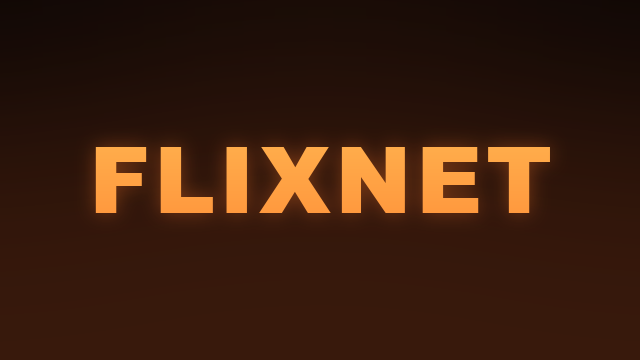

<div align="center">



### Your own movies and series, from a USB drive, on the TV.

</div>

FLIXNET is an optional TV app that shows the movies and series on a USB drive or hard disk the way a streaming app does: the highlighted title big at the top, with rows of posters under it. Plug a drive in and it fills up by itself; take it out and they go.

- **Rows:** Continue watching, Recently added, Movies, Series, and a row per genre.
- **Details:** the background, title, year, rating, runtime, score, description, cast and director. Movies have **Play**, or **Resume** and **Start over**. Series pick up where you were, with seasons and episodes underneath.
- **The player:** resume where you stopped, subtitles from `.srt` files, and the next episode starts by itself.
- **Telebisyon's web page** gets a FLIXNET page listing everything found, and what needs fixing (no poster, a broken `info.json`…).

It's a separate app from Telebisyon, built and installed on its own.

## Install

On a computer on the same Wi-Fi as the TV, with debugging on (as for Telebisyon):

```sh
sh flixnet.sh <TV_IP>          # installs or updates it
sh flixnet.sh <TV_IP> off      # uninstalls it
```

It builds FLIXNET if the computer can (Java 17 and the Android SDK, see `build.sh`), or downloads the latest release. It also lets FLIXNET read drives: TVs have no screen to ask for that.

Then open **FLIXNET** from the TV's apps. On Telebisyon's home screen, add it with the **Add app** tile.

## Arrange the drive

A **Movies** and a **Series** folder at the top of the drive, one folder per movie or series:

```
Movies/Inception/movie.mkv, poster.jpg, background.jpg, info.json
Series/The Office/poster.jpg, background.jpg, info.json, Season 1/01 Pilot.mp4
```

`info.json` needs only a **title** and a **description**: year, release date, rating, score, runtime, genres, cast, director, language and tagline are optional. Everything is in [docs/library.md](docs/library.md).

## On the TV

| Where | Keys |
|---|---|
| The rows | Arrows to move, **OK** to open. |
| Details | **OK** on Play or Resume. Series: down to the seasons and episodes. |
| Playing | **OK** pauses, **◀ ▶** skip 10 seconds (further while held), rewind and fast forward skip 30, **▼** turns subtitles on or off, **Back** stops (and remembers where). |

## Build it yourself

```sh
sh build.sh        # out/flixnet.apk
```

Plain Java, no libraries, no Gradle: Java 17 and the Android SDK (platform 34, build-tools 34.0.0). `art.py` redraws the icon and banner.

**Signing:** inside the Telebisyon folder, it's signed with Telebisyon's `key.jks`; on its own, with a `key.jks` of its own made on the first build. Telebisyon's FLIXNET page only works when both apps have the **same key**: set `KEYSTORE` and `KEYSTORE_PASS` to Telebisyon's to keep it working after moving this folder out.

## Credits

FLIXNET is part of [Telebisyon](../README.md) by knz. MIT License.
