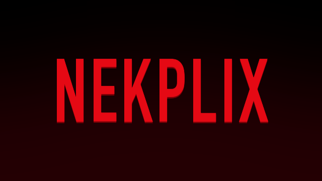

<div align="center">



### Your own movies and series, on the TV and in any browser.

</div>

NEKPLIX shows the movies and series on a USB drive, a hard disk, a computer or a phone the way a streaming app does: the highlighted title big at the top, with rows of posters under it. Plug a drive in and it fills up by itself; take it out and they go.

It comes in three parts, all in this folder:

| | What it is | Where it runs |
|---|---|---|
| **NEKPLIX** | The app you watch on | Android TV, Google TV, TV boxes |
| **NEKPLIX Share** | Shares a folder or drive over the Wi-Fi | Mac, Windows, Linux (`share.py`) |
| **NEKPLIX Share for Android** | Shares a phone's or box's drives, and serves NEKPLIX to **browsers** | Android phones, tablets, TV boxes |

**Contents:** [What it does](#what-it-does) · [Install on the TV](#install-on-the-tv) · [Arrange the drive](#arrange-the-drive) · [Where the movies can be](#where-the-movies-can-be) · [Watch in a browser](#watch-in-a-browser) · [On the TV](#on-the-tv) · [What plays](#what-plays) · [When a drive doesn't show up](#when-a-drive-doesnt-show-up) · [Build it yourself](#build-it-yourself)

## What it does

- **The intro:** opening NEKPLIX shows its logo growing out of the dark with a red glow, then zooming into the main screen, while it looks for your films. Any button skips it. For a sound with it, put a short AAC file at `res/raw/intro.m4a` before building (it isn't included).
- **Featured at the top:** a few films take turns every 9 seconds (what you're watching first, then some at random), each with its background slowly zooming out, the score in green, the rating and HD in boxes, and **Play** and **More info**. Go down to the rows and the top follows the poster you're on instead.
- **Rows:** Continue watching and Recently added as wide pictures with the title on them; Movies, Series, a row per collection (all the Fast & Furious films together, in order) and a row per genre as posters.
- **Search:** at the top right. Type on an on-screen keyboard made for the remote (or speak, if the TV has voice input); the titles that match show as you pause typing, by name, collection, genre, actor, director or year.
- **Details:** the background, title, score, year, rating, length, the tagline in italics, the description, cast and director. Movies have **Play**, or **Resume** and **Start over**; series pick up where you were, with seasons and episodes underneath. At the bottom: the rest of the collection, or *More like this*.
- **The player:** resumes where you stopped, plays the next episode by itself, and shows subtitles from `.srt` files or from inside the video, in every language you have.
- **On Telebisyon:** NEKPLIX joins the apps row on the home screen, and Telebisyon's web page gets a **NEKPLIX library** tile listing everything found, and what needs fixing (no poster, a broken `info.json`…).

It's a separate app from Telebisyon, and works without it.

## Install on the TV

On a computer on the same Wi-Fi as the TV, with network debugging on (as for Telebisyon):

```sh
sh nekplix.sh <TV_IP>          # installs or updates it
sh nekplix.sh <TV_IP> off      # uninstalls it
```

It builds NEKPLIX if the computer can (see [Build it yourself](#build-it-yourself)), or downloads the latest release. It also lets NEKPLIX read drives, since TVs have no screen to ask for that, and puts NEKPLIX at the end of Telebisyon's apps row if Telebisyon is installed. Otherwise, open it from the TV's apps.

## Arrange the drive

A **Movies** and a **Series** folder at the **top** of the drive, one folder per movie or series:

```
Movies/
  Inception (2010)/          movie.mkv, poster.jpg, background.jpg, info.json, movie.en.srt
  Fast & Furious Collection/ a folder of film folders is a collection
Series/
  The Office/                poster.jpg, background.jpg, info.json
    Season 1/                01 Pilot.mp4, 02 Diversity Day.mp4
```

- Only what's inside **Movies** and **Series** shows: films anywhere else on the drive don't.
- `info.json` needs only a **title** and a **description**. Year, rating, score, runtime, genres, cast, director, tagline and `"collection": "Fast & Furious"` are optional. Without one, the folder's name is the title.
- Episodes go in a folder per season, straight inside the series' folder, not deeper.

Everything, with examples: **[docs/library.md](docs/library.md)**.

## Where the movies can be

NEKPLIX shows every source it finds side by side. Computers and phones sharing on the Wi-Fi are found by themselves (it looks every 30 seconds while it's open).

### A USB drive or hard disk in the TV

Plug it in; it shows within seconds. The TV must be able to mount it: see [When a drive doesn't show up](#when-a-drive-doesnt-show-up).

### A computer: NEKPLIX Share

Movies can stay on a laptop, or on a hard disk plugged into it.

- **Mac:** build the app once, in `share-app/`: `sh make-mac-app.sh` makes **NEKPLIX Share.app**. Double-click it, choose the folder or drive (a hard disk is under **Locations**), and it shares in the background, showing the [browser](#watch-in-a-browser) link with **Copy link** and **Show QR code**. Open it again for the link and QR code, or to **Stop sharing**; next time it offers the same folder.
- **Windows:** double-click **NEKPLIX Share.bat** in `share-app/`, choose the folder, and it shares until you close its window, which shows the browser link. It needs [Python 3](https://www.python.org/downloads/) (tick *Add python.exe to PATH*); allow *Private networks* when Windows asks.
- **Any computer, from a terminal:**

  ```sh
  python3 share.py /Volumes/Movies          # the folder or drive with Movies and Series in it
  python3 share.py ~/Movies --name "Den"    # the name the TV shows (default: the computer's)
  ```

Choose the folder **holding** Movies and Series (the drive itself, usually), not Movies. Good to know:

- **Read-only**, only Movies and Series.
- **Pictures come small**, as from a phone: made with macOS's `sips`, or [Pillow](https://pypi.org/project/Pillow/) elsewhere if it's installed (else full size), and kept in a cache folder.
- **With `ffprobe`** (part of ffmpeg: `brew install ffmpeg` on a Mac) it reads each video's codecs in the background, so the browser version shows each browser exactly what it can play. Without it, browsers see MP4s, and MKVs in Chrome and Edge.
- **A Mac stays awake while a video plays**, and sleeps otherwise. Elsewhere, keep the computer from sleeping yourself.
- If macOS asks to **allow incoming connections** for Python, click **Allow**.
- Ports 8765 (files) and 8766 (finding it).

### A phone, tablet or TV box: NEKPLIX Share for Android

Plug the drive into an Android phone (with a USB OTG adapter), tablet or TV box, and the TV plays it over the Wi-Fi. Handy when the TV won't read a drive.

1. Install `share-android/out/nekplix-share.apk` (build it with `cd share-android && sh build.sh`): copy it to the phone and open it, or `adb install` it.
2. Open **NEKPLIX Share** and tap **Allow access to drives** (Android's *All files access* switch).
3. On a phone, tap **Choose a USB drive** and pick the drive itself, once per drive: phones keep USB drives from apps otherwise.
4. Tap **Start sharing**.

It shares every drive with a Movies or Series folder at its top, each as its own source on the TV, and a **Nekplix** folder on the device's own storage.

- **It goes on with the screen off and the phone asleep**, with a notification to stop it. On a Samsung, set *Settings → Apps → NEKPLIX Share → Battery* to **Unrestricted** for long evenings, and keep the phone charging.
- **It stops by itself after two hours with no TV or browser using it.** Updating the app doesn't stop it: if it was sharing, it starts again by itself.
- **The TV finds it even when the phone is asleep.** A sleeping phone doesn't hear the TV asking the Wi-Fi who's sharing, so NEKPLIX remembers the phones and computers it has found and asks them directly too. The very first time, wake the phone's screen.
- **Pictures come small:** the phone resizes posters and backgrounds for the TV and browsers and keeps them, so rows and search fill in quickly.
- **Several people can watch at once**, each a different film: a phone sends about 10 MB/s in all, and a typical film needs 0.2 to 1 MB/s.
- On a TV box without the *All files access* screen: `adb shell appops set com.knz.nekplix.share MANAGE_EXTERNAL_STORAGE allow`.

## Watch in a browser

While **NEKPLIX Share** shares, from a computer or a phone, it also serves NEKPLIX to **any browser on the same Wi-Fi**: phones, tablets, laptops. Open the address it shows (like `http://192.168.1.20:8765`):

- **On Android**, the app shows it with **Open**, **Copy** and **Share**, and a **QR code** to scan with a phone's camera.
- **On a Mac**, the app shows it with **Copy link** and **Show QR code**, when it starts and whenever you open it again. **Show QR code** opens a page in your browser with the link big and a QR code, for others to scan off your screen.
- **On Windows or in a terminal**, `share.py` prints it, and the address of that QR page (the link with `/qr` on the end).

- The same rows, collections, search, details, seasons, related titles and subtitles as on the TV, in a streaming-app style: a featured film at the top that changes every few seconds, Continue watching and Recently added as wide pictures, posters for the rest. *Continue watching* is kept in each browser.
- **On a computer, hovering** a wide picture opens a bigger preview with Play, More info and the details; a poster lifts a little and shows Play, More info, the score and year. **/** jumps to search, **Esc** closes.
- **It shows only what that browser can play.** The phone (or the computer, with `ffprobe`) reads each video's format once, in the background, and the page leaves out the rest:

  | Browser | Plays |
  |---|---|
  | Chrome, Edge (Android, Windows, Mac) | MP4, and MKV with H.264 or H.265 video and AAC or MP3 sound |
  | Safari (iPhone, iPad, Mac) | MP4 only |
  | None | XviD or DivX video, AC3 or DTS sound: these play on the TV |

- **No password:** anyone on the same Wi-Fi can open it, read-only, and see only the Movies and Series folders. Share on Wi-Fi you trust.

## On the TV

| Where | Keys |
|---|---|
| The top | **Play** or **More info** for the featured film; **Down** to the rows; **Up**, or **Right** from More info, reaches **Search**. |
| The rows | Arrows to move, **OK** to open. **Up** from the first row goes back to the featured films. |
| Search | Arrows and **OK** on the letters, or type on a keyboard or the remote's number keys; **🎤** to speak. Right goes to the results. |
| Details | **OK** on Play or Resume. Series: down to the seasons and episodes. |
| Playing | **OK** pauses, **◀ ▶** skip 10 seconds (further while held), rewind and fast forward skip 30, **▼** goes through the subtitles (off, then each one; remembered for the next video), **Back** stops and remembers where. |

## What plays

NEKPLIX plays with the TV's own player, so it plays what the TV's hardware can: most **MP4** and **MKV** files with **H.264** or **H.265** video and AAC, AC3 or MP3 sound. If a file won't play, NEKPLIX says so.

**AVI files** don't play on Android TVs, but what's inside them usually does. `avi2mkv.sh` copies every AVI on a drive into an MKV, without re-encoding (no loss of quality, a minute or two a film, limited by the drive's speed). It needs ffmpeg (`brew install ffmpeg` on a Mac):

```sh
./avi2mkv.sh /Volumes/Movies             # each AVI moved to "AVI originals" once its MKV checks out
./avi2mkv.sh /Volumes/Movies --delete    # or deleted
```

Samples and ads are left alone, and running it again skips what's done.

## When a drive doesn't show up

If the TV (or a phone) doesn't show a drive at all, not even in its own file manager, it's the drive's format, not NEKPLIX:

- **"Use as device storage" was chosen on the TV.** Android then encrypts the drive as part of the TV's storage: no other device can read it, and NEKPLIX can't use it as a movie drive. Erase it as removable storage: on the TV, *Settings → Storage →* the drive *→ Erase & format as removable storage*, or on a Mac, Disk Utility → *Erase*, **MS-DOS (FAT)** with **Master Boot Record**.
- **A Mac hard disk with a "hybrid MBR".** macOS doesn't mind, but Android refuses the drive (its log says `sgdisk failed to scan`). It can be fixed without erasing anything. In Terminal, with `brew install gptfdisk`:

  ```sh
  sudo gdisk -l /dev/diskN | head -8                                 # "MBR: hybrid"? diskN from: diskutil list
  sudo sgdisk --backup="$HOME/partition-backup.bin" /dev/diskN       # a backup, to undo it
  diskutil unmountDisk diskN
  printf 'x\nn\nw\nY\n' | sudo gdisk /dev/diskN                      # a protective MBR instead
  sudo gdisk -l /dev/diskN | head -8                                 # now "MBR: protective"
  ```

  The partitions and files stay as they are. Undo: `sudo sgdisk --load-backup="$HOME/partition-backup.bin" /dev/diskN`.
- **exFAT, NTFS, FAT32:** most Android TVs and phones read them. If one doesn't, share the drive from a computer or phone instead.

If the drive shows but some films don't, check they're inside **Movies** or **Series**, one folder each: Telebisyon's **NEKPLIX library** page lists what needs fixing.

## Build it yourself

Plain Java, no libraries, no Gradle: Java 17 and the Android SDK (platform 34, build-tools 34.0.0).

```sh
sh build.sh                         # out/nekplix.apk, the TV app
cd share-android && sh build.sh     # out/nekplix-share.apk, NEKPLIX Share for Android
cd share-app && sh make-mac-app.sh  # NEKPLIX Share.app, for a Mac
```

`art.py` redraws the icon and banner.

**Signing:** inside the Telebisyon folder, both apps are signed with Telebisyon's `key.jks`; on their own, with a `key.jks` made on the first build. Telebisyon's NEKPLIX library page only works when NEKPLIX and Telebisyon have the **same key**: set `KEYSTORE` and `KEYSTORE_PASS` to Telebisyon's if you move this folder out.

## Credits

NEKPLIX is part of [Telebisyon](../README.md) by knz. MIT License.
